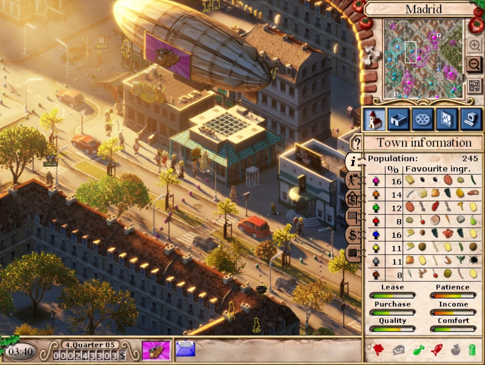

# Pizza Connection 2 Fix

# Fixes
- Modify game speed with number keys. (1, 2, 3, 4)
- Improves framerate, no more 12 fps lock when idle.
- Allow for windowed mode. (Add -windowed in launch options)
- Improve loading times.

# How to install
1. Download latest release build from [here](https://github.com/mallgrab/pc2fix/releases).
2. Extract the zip file.
3. Drag and drop all files into the game's folder, overwrite if asked.
4. Enjoy making pizzas. 😎

# TODO
- Implement widescreen, game locks the backsurface and frontsurface, draws entities to the surface then blt/bltfast.
- Multiplayer? Local multiplayer might be doable.